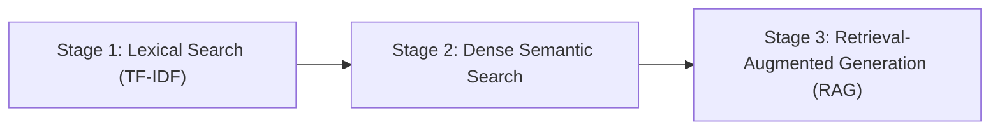
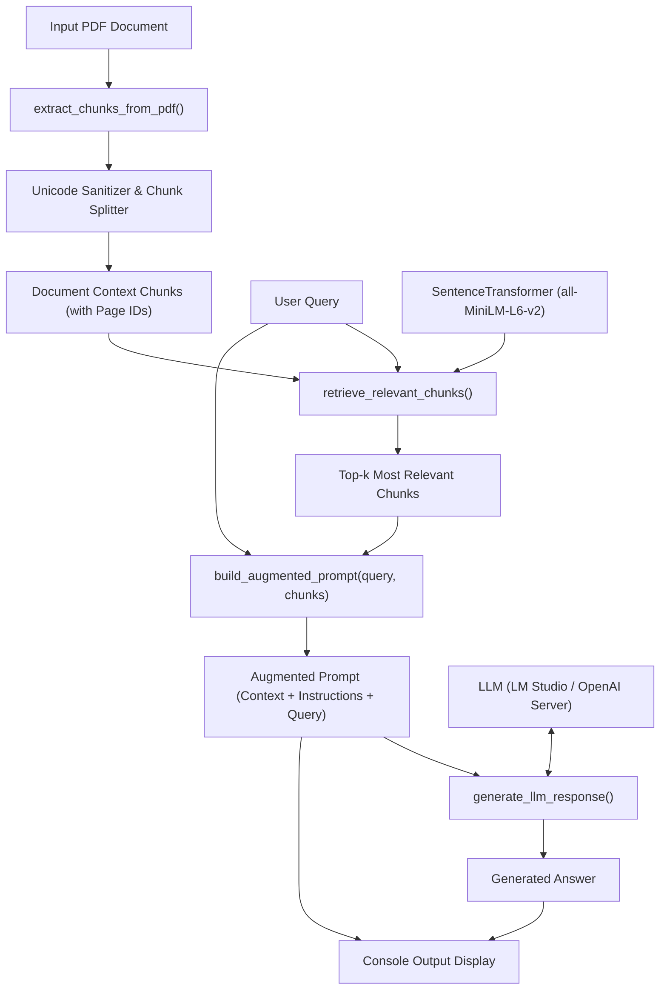

# Project Architecture: PDF Search & RAG Tool

## Overview
The PDF Search & RAG Tool is a command-line application that bridges document understanding with generative AI. It allows users to ask natural language questions against large PDF documents and receive grounded, accurate answers backed by cited page excerpts.

---

## Architectural Evolution

### Stage 1: Lexical Search (TF-IDF)
- **Mechanism:** Text parsed with `pypdf`, vectorized using `scikit-learn`'s `TfidfVectorizer`, and compared via cosine similarity.
- **Limitation:** Relied strictly on exact keyword matching. Failed on synonymous queries (e.g. searching "risks of database exploits" missed pages discussing "SQL injection").

### Stage 2: Dense Semantic Search (Sentence Transformers)
- **Mechanism:** Leveraged `sentence-transformers/all-MiniLM-L6-v2` to map queries and document pages into a shared 384-dimensional dense semantic vector space.
- **Improvement:** Understood meaning, synonyms, and conversational formulations.
- **Limitation:** Only returned raw text chunks and numerical scores. The user still had to read through the retrieved excerpt to synthesize the answer.

### Stage 3: Retrieval-Augmented Generation (RAG) — Current Architecture
- **Mechanism:** Combines dense semantic retrieval with an LLM generation pipeline:
  1. Retrieves top-$k$ relevant chunks from the PDF.
  2. Augments the user's query with the retrieved chunks into an explicit prompt.
  3. Sends the augmented prompt to an LLM (local server via LM Studio / Ollama, or OpenAI API).
  4. Outputs both the **augmented prompt** and the **synthesized answer**.
- **Advantage:** Delivers direct, conversational, grounded answers with citations and zero hallucination.

---

## Software Architecture & Modular Design

### Core Components in `pdf_search.py`:

1. **`extract_chunks_from_pdf(pdf_path, max_chunk_chars, overlap)`:**
   - Parses pages using `pypdf.PdfReader`.
   - Cleans whitespace and strips unpaired UTF-16 surrogates (`encode('utf-8', 'ignore')`).
   - Slices pages exceeding `max_chunk_chars` into overlapping segments to prevent information loss at chunk boundaries.
   - Attaches `chunk_id` and `page` metadata to every chunk.

2. **`retrieve_relevant_chunks(chunks, query, top_k, model_name)`:**
   - Loads `all-MiniLM-L6-v2`.
   - Encodes query and all document chunks into PyTorch tensors.
   - Computes cosine similarity scores via `util.cos_sim`.
   - Returns the top-$k$ most relevant chunks ranked by similarity.

3. **`build_augmented_prompt(query, chunks)`:**
   - Constructs a standardized prompt template containing:
     - Clear persona instructions (rely strictly on provided context, no hallucinations).
     - Formatted context chunks labeled with originating page numbers.
     - The user's query question.

4. **`generate_llm_response(augmented_prompt, base_url, api_key, model_name, mock, chunks)`:**
   - Initializes an `openai.OpenAI` client pointing to the target base URL (default: `http://localhost:1234/v1`).
   - Issues a chat completion request with low temperature (0.3) for factual precision.
   - Gracefully handles server unavailability by catching connection errors and printing clear diagnostic steps.
   - Provides `--mock` support for offline testing.

5. **`rag_search(...)` & `main()`:**
   - Orchestrates the full pipeline.
   - Supports both interactive CLI prompts and non-interactive command-line arguments (`argparse`).
