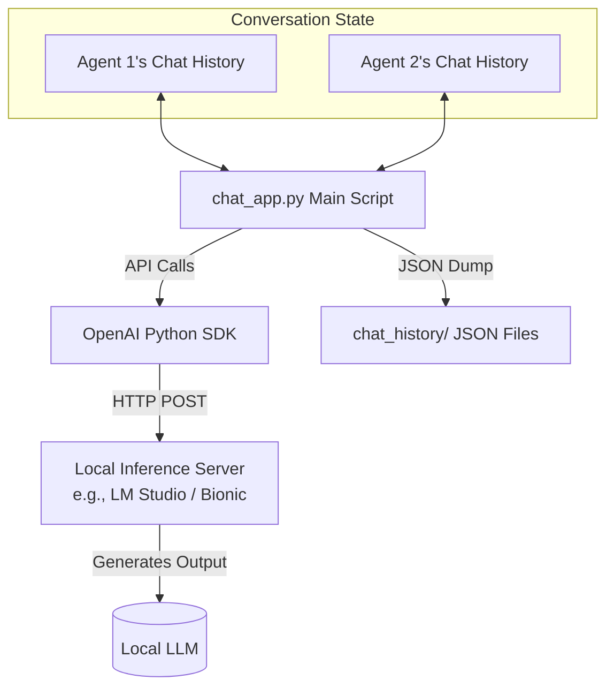

# Software and Technical Architecture

This document outlines the architecture for the **Bot-to-Bot Chat Application** built in Assignment-2. The application is a lightweight Python script that orchestrates a conversation between two autonomous agents powered by a local language model.

## 1. High-Level Architecture Diagram

## 2. Core Components

### 2.1. The Client Application (`chat_app.py`)
This is the main orchestration script. Its primary responsibilities include:
- Initializing the connection to the model endpoint.
- Bootstrapping the conversational state via interactive user inputs (seed message and rounds).
- Running the sequential request/response turn-loop for the predefined number of iterations.
- Gracefully handling connection exceptions or API errors.

### 2.2. Context & State Managers
Language models are inherently stateless. To simulate a continuous conversation, the script manages state locally:
- **`bot1_history` and `bot2_history` lists:** Each bot maintains its own independent list of message dictionaries. 
- **System Prompts:** At index `0` of each list, a `"role": "system"` message is placed to permanently dictate the distinct personality and behavioral boundaries of that specific bot.

### 2.3. The Integration Layer (OpenAI SDK)
Instead of using external cloud services, the application utilizes the **OpenAI Python SDK** as an abstraction layer to communicate with a local server. By overriding the `base_url` parameter (e.g., to `http://localhost:1234/v1`), the script forces the SDK to route standard OpenAI API requests (like `/chat/completions`) to the local machine.

### 2.4. Local Inference Server (Bionic/LM Studio)
A local API server that mimics the OpenAI API schema. It receives the HTTP requests from the SDK, tokenizes the history, queries the underlying open-weights language model, and returns the response in standard JSON format.

### 2.5. Logging Manager
A secondary state array (`chat_log`) is maintained alongside the individual bot histories. It captures the role and content of each generated message sequentially. After the conversation loop completes, this array is serialized into a formatted `.json` file stamped with the current datetime and safely written to the isolated `chat_history/` directory.

## 3. Data Flow and Role Flipping

The key architectural pattern in this application is **Role Flipping** to ensure each bot perceives the conversation correctly. 

When Agent A generates a message:
1. The message is appended to **Agent A's history** as an `"assistant"` message (because Agent A generated it).
2. The exact same message text is appended to **Agent B's history** as a `"user"` message (because from Agent B's perspective, the "user" is talking to it).

This mechanism allows two separate instances of the same model (or different models) to talk to each other without becoming confused about who said what.
