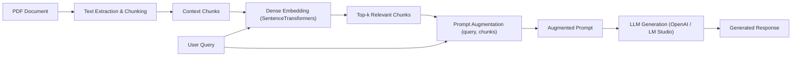

# About Assignment 3: RAG System

## Objective
The objective of **Assignment 3** is to evolve the PDF similarity search tool from Assignment 1 into a complete **Retrieval-Augmented Generation (RAG)** pipeline.

In the original Assignment 1 tool, semantic search identified the most relevant page and printed the raw excerpt and similarity score. In Assignment 3:
1. Relevant document chunks are retrieved based on semantic similarity.
2. The user query and the retrieved context chunks `(query, chunks)` are synthesized into an **Augmented Prompt**.
3. An LLM generates an answer grounded strictly in the retrieved excerpts.
4. The application prints both the **Augmented Prompt** and the **Generated Response**.

---

## Technical Pipeline

### 1. Document Extraction & Preprocessing
- **Tool:** `pypdf.PdfReader`
- **Unicode Normalization:** Strips lone UTF-16 surrogates (e.g. `\ud800`) commonly produced by PDF font streams, preventing Hugging Face tokenization crashes.
- **Chunking:** Pages are extracted and split into contextual chunks (maximum 1,200 characters with 150-character sliding overlap for long pages) to retain cohesive local context while maintaining page metadata.

### 2. Dense Semantic Retrieval
- **Model:** `sentence-transformers/all-MiniLM-L6-v2`
- **Vector Space:** High-dimensional dense vectors (384 dimensions).
- **Matching Metric:** Cosine similarity between query embedding and chunk embeddings:
  $$\text{sim}(q, c) = \frac{\mathbf{q} \cdot \mathbf{c}}{\|\mathbf{q}\| \|\mathbf{c}\|}$$
- **Top-$k$ Selection:** Retains the top-$k$ (default 3) highest scoring chunks.

### 3. Prompt Augmentation
The retrieved chunks and user question are composed into a strict prompt:
- **Instructional Guardrails:** Directs the model to answer solely using the provided context, cite page numbers, and explicitly report if information is absent.
- **Context Blocks:** Labeled with chunk IDs and page numbers for easy attribution.
- **User Query:** Clearly framed at the end of the prompt.

### 4. Generation & Display
- **Inference Client:** `openai.OpenAI` SDK pointing to local server (`http://localhost:1234/v1`) or cloud endpoints.
- **Console Presentation:** Renders the exact **Augmented Prompt** sent to the LLM followed by the **Generated Response**.
