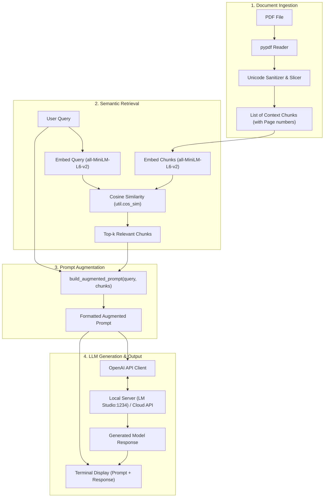

# Architecture: Assignment 3 RAG System

## System Overview
The Assignment 3 RAG System connects document parsing, dense semantic embeddings, prompt augmentation, and LLM inference into a cohesive command-line workflow.

---

## Component Details

### 1. `extract_chunks_from_pdf`
- Parses each page of the PDF using `pypdf`.
- Cleans whitespace and cleans invalid Unicode code points.
- If a page is longer than 1,200 characters, it slices it with a 150-character sliding overlap at word boundaries to prevent context fragmentation.
- Outputs structured dictionaries with `chunk_id`, `page`, and `text`.

### 2. `retrieve_relevant_chunks`
- Uses PyTorch and `SentenceTransformer('all-MiniLM-L6-v2')`.
- Encodes queries and chunks into 384-dimensional dense vectors.
- Computes cosine similarity scores and retrieves the top-$k$ chunks.

### 3. `build_augmented_prompt`
- Combines `query` and `chunks` into a standardized, grounded prompt format.
- Adds context headers with page citations.
- Enforces anti-hallucination instructions.

### 4. `generate_llm_response`
- Connects to an OpenAI-compatible endpoint.
- Submits system and user messages with temperature 0.3 for deterministic and grounded answers.
- Gracefully handles server errors with actionable instructions.
- Includes a `--mock` response generator for testing in offline environments.

### 5. `rag_search` & `main`
- Drives the end-to-end flow.
- Supports both interactive input and command-line flags.
- Prints the exact augmented prompt sent to the LLM and the generated response.
